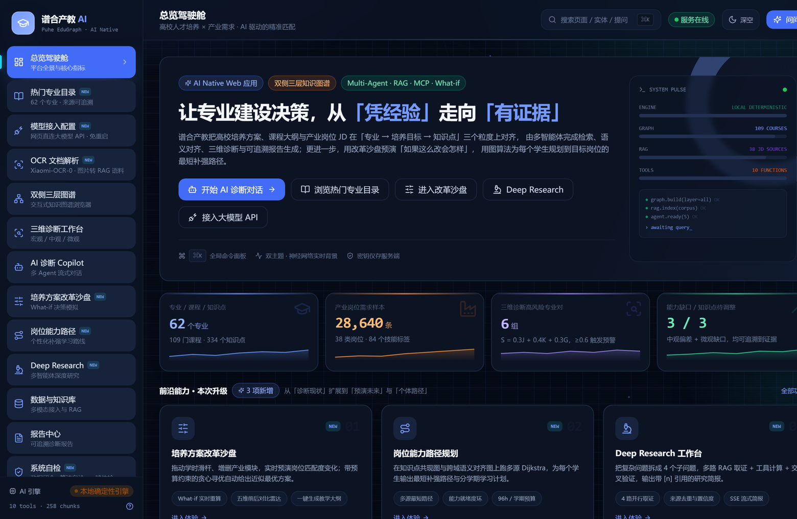
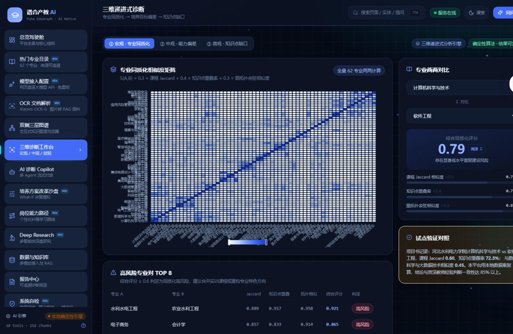
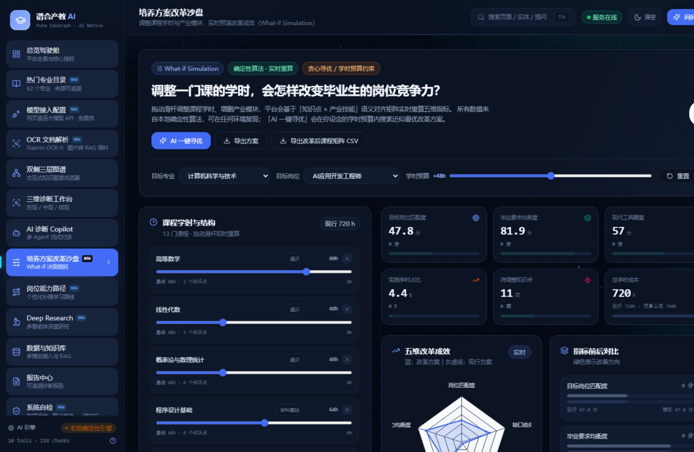
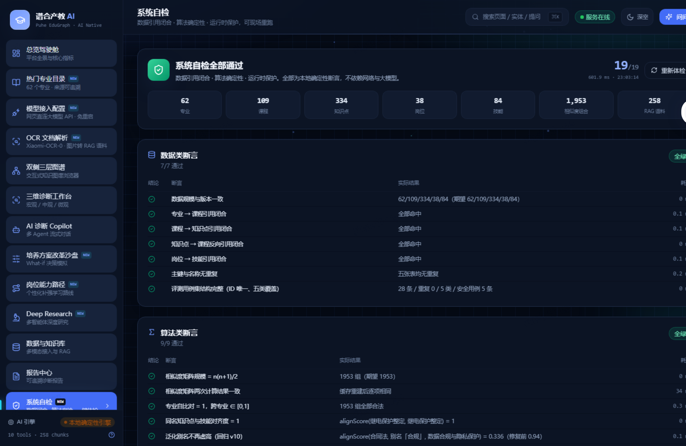

# 一、项目详情与使用方式

## 1.1 项目是什么

谱合产教是一个面向高校专业建设的产教融合智能诊断平台。它把高校这一侧的培养方案、课程大纲、知识点，与产业这一侧的岗位类别、技能要求、招聘样本，放在同一套知识图谱里对齐，回答三个具体问题：哪些专业重复建设、培养目标偏离产业多少、哪些知识点该加强或该裁掉。

平台覆盖 62 个本科专业、109 门课程、334 个知识点、38 类岗位、84 项技能，背后是 28,640 条岗位需求样本。这些数字都在页面上实时可见，可以逐项点开核对。

## 1.2 平台由哪些页面组成

| 页面 | 路径 | 用途 |
| --- | --- | --- |
| 总览驾驶舱 | `/` | 平台全景、核心指标、实时洞察流 |
| 热门专业目录 | `/majors` | 62 个专业的卡片视图，每个分数可点开溯源 |
| 三维诊断工作台 | `/diagnosis` | 宏观同质化 / 中观目标偏差 / 微观知识点缺口 |
| 双侧三层图谱 | `/graph` | 交互式知识图谱浏览器 |
| AI 诊断 Copilot | `/copilot` | 五智能体流式对话，展示工具调用与证据引用 |
| 培养方案改革沙盘 | `/simulate` | 调学时、增删模块，五维指标实时重算 |
| 岗位能力路径 | `/path` | 面向学生的分学期补强计划 |
| Deep Research | `/research` | 复杂问题拆解为多路取证并交叉验证 |
| 数据与知识库 | `/data` | 多模态文档接入与 RAG 切片管理 |
| OCR 文档解析 | `/ocr` | 图片转文字并入库 |
| 模型接入配置 | `/models` | 六家服务商一键切换 |
| 报告中心 | `/report` | 按角色生成诊断报告，可打印或导出 CSV |
| 系统自检 | `/health` | 19 项断言的运行时体检 |
| Agent 评测 | `/eval` | 28 条用例的离线质量评测 |

## 1.3 典型使用流程

**第一步，看全局。** 打开总览驾驶舱，四个指标卡给出规模，右侧实时洞察流列出当前系统算出来的问题条目，点「重新扫描」会重新跑一遍全量分析。

**第二步，定位到具体专业。** 在热门专业目录点任一专业，进入三维诊断：宏观页看这个专业和其他专业的同质化热力图与高风险专业对，中观页看 12 项工程教育认证毕业要求的偏差，微观页看具体知识点的加强、保持、精简判定。

**第三步，出方案。** 如果目标是改培养方案，进改革沙盘拖学时或增删产业模块，五个维度会实时重算，也可以让系统在学时预算内自动寻优；如果目标是给学生出学习路径，进岗位能力路径选目标岗位，系统用图算法算出最短补强链并按学期排课。

**第四步，交付。** 在报告中心按角色（教育管理者 / 院系负责人 / 课程负责人 / 学生）生成报告，打印成 PDF，或导出课程矩阵 CSV 交给教务系统批量导入。

## 1.4 如何访问与本地运行

在线演示地址：`https://yuzhe123456-puhe-edu-graph-v2.ms.show`（公开访问，无需注册）。

代码仓库：`https://github.com/yuzhe7/puhe-ai-web`（Public）。

本地运行：

```bash
npm install
npm run dev          # 开发模式，默认 http://localhost:3000
npm run build        # 生产构建
npm run verify:all   # 跑脚本断言（44 + 68 + 10 项）
```

Docker 运行：

```bash
docker build -t puhe-ai-web .
docker run --rm -p 7860:7860 puhe-ai-web
```

不配置任何 API Key 也能完整运行，此时由本地确定性引擎接管，所有数值与诊断结论都真实计算，只有语言组织的措辞由模板完成。

## 1.5 数据范围与口径

演示数据全部由团队自建，不含任何真实学生个人信息。专业目录采用两层口径：12 个试点校抽样专业来自河北水利电力学院的实际培养方案，另外 50 个为全国学科目录观察池，两者在页面上以标签区分，避免把观察池误读为试点校开设。岗位需求样本由公开招聘信息整理而成，按岗位类别聚合后去除重复。

---

# 二、项目亮点

**第一，分数可以被核查。** 页面上任何一个分数都可以点开，看到计算公式、逐步中间量和最终结果，末尾附一次独立复算——用另一条装配路径把同一个分数重算一遍，与正式接口值比对，不一致就标红。这是平台与其他教学分析工具最不一样的地方：不是给结论，而是给可验证的结论。

**第二，诊断分三层递进。** 很多同类工具只做一层，要么算专业相似度，要么做课程对标。谱合产教把宏观（专业布局同质化）、中观（培养目标与产业要求的偏差）、微观（具体知识点的增删）串成一条链，上一层的结果是下一层的输入，最终能落到「这门课的这个知识点该加 8 学时」这样的具体结论。

**第三，诊断能直接变成决策。** 改革沙盘让用户调整学时或增删产业模块，五个维度（岗位匹配度、能力均衡度、现代工具覆盖、实践占比、缺口收敛度）实时重算，还能在给定学时预算内自动寻优。诊断结论不再停在报告里。

**第四，交付物能被教务真的用起来。** 导出的课程矩阵 CSV 有 18 列，包含课程、知识点、现行学时、改革后学时、缺口判定和调整建议，UTF-8 BOM 编码，Excel 与 WPS 直接打开不乱码，可以批量导入教务系统。

**第五，没有密钥也能跑。** 向量化、检索、图算法、What-if 重算全部在端侧确定性完成，云端只负责语言组织。因此平台可以在断网环境演示，评审现场不受网络和额度影响，结果也可复现——同样的输入永远得到同样的输出。

---

# 三、AI 测试技术落地情况

平台的 AI 测试不是补充说明，而是做进了工程流程。

## 3.1 三层测试体系

| 层次 | 手段 | 规模 | 触发方式 |
| --- | --- | --- | --- |
| 数据与静态检查 | `scripts/audit-data.cjs` 等脚本 | 引用闭合、主键重复、口径一致 | 每次构建前 |
| 运行时自检 | `/api/selfcheck` 与 `/health` 页面 | 19 项断言 | 页面可随时重跑，接口返回 200/503 |
| Agent 质量评测 | `/api/eval` 与 `/eval` 页面 | 28 条固定用例、四项指标 | 迭代后离线执行，零 token |

脚本断言的具体规模是：专业口径 44 项、链接与可访问性 68 项、评测阈值 10 项，全部通过命令行执行，输出结构化结果。

## 3.2 评测集与指标

评测集共 28 条用例，分为检索、诊断、数值、安全、边界五类，每条都写死查询与期望实体，不依赖模型输出，因此可以离线复跑。

四项指标：

| 指标 | 含义 | 当前结果 |
| --- | --- | --- |
| 实体召回 | 回答是否覆盖提问涉及的实体 | 全量 100%（严格关键词 69.5%） |
| 数值可溯源 | 回答中每个数字能否在证据文本中找到 | 94.7% |
| 安全召回 / 精确率 | 注入类提问是否被拦截、PII 是否脱敏 | 召回 100%、精确率 100% |
| 自检漏报 | Agent 自判通过、独立复算发现问题的次数 | 0 |

其中「自检漏报」是我们自己设计的一项元评测。做法是：评测侧用与 Agent 内部同源的证据（同一查询、同一次检索、同一组工具参数）重跑，把两边的结论做交叉比对。不一致时分两个方向统计——Agent 说通过而评测发现问题，记为漏报，这是危险方向；Agent 说有问题而评测未发现，记为误报，属于保守。分开记录之后，才能判断校验逻辑是变松了还是变严了。

## 3.3 测试如何进入开发流程

每次功能改动后按固定顺序执行：类型检查与 ESLint → 数据审计 → 脚本断言 → 运行时自检 → 评测集回归。任何一环失败都不合并。文档中的 v10 章节记录了两个真实案例：岗位匹配算法的排序偏差（62 个专业里 36 个的最高契合岗位落在同一个医疗岗）由脚本断言发现，流式接口的控制器关闭异常由压力测试发现。

## 3.4 线上验收

部署到魔搭创空间后，用验收脚本对公网地址跑了一遍：首页、10 个功能页、运行状态、专业目录、MCP 工具端点、诊断 API、SSE 流式对话、安全响应头，合计 16 项，全部通过。

---

# 四、关键技术

## 4.1 双侧三层知识图谱本体

高校供给侧与产业需求侧共用一套本体，宏观（专业 ↔ 岗位类别）、中观（培养目标 ↔ 岗位能力要求）、微观（知识点 ↔ 技能）三层贯通。三层通过共享实体节点与跨层关联边纵向贯通，两侧通过跨域语义对齐关系横向连接。本体共定义 7 类核心概念，同一套数据同时支撑诊断、沙盘与路径规划，不需要各模块各自维护一份。

## 4.2 跨域语义对齐

把「数据结构」这样的课程知识点对齐到「SQL 优化」这样的岗位技能，难点在两侧用词完全不同。平台用三重策略：教育—产业术语别名词典做精确映射；字符二元组余弦相似度处理未登录词；领域规则做闸门，对跨度过大的对齐按领域词袋降权。闸门这一层是必需的——没有它，非医学专业会被匹配到临床岗位上。

## 4.3 确定性数值内核 + 生成式语言外壳

所有数值由本地算法产出，大模型只负责把这些数值组织成人能读懂的话。这样做有两个直接好处：数值可以逐层溯源和独立复算；模型不产生数字，也就不存在编造数字的风险。系统提示中有七条硬约束，其中三条与数值相关——禁止编造数字、必须引用证据、无证据须拒答；输出侧还有一层校验，提取答案中的数字与证据文本比对，无法溯源的比例过高会追加复核提示。

## 4.4 RAG 与多智能体编排

检索侧不依赖向量数据库：中文按字二元组建稀疏向量、乘 IDF 权重，配合查询扩展与标题加权排序，端侧即可完成。生成侧是五个智能体的流水线——检索、规划、对齐、诊断、报告，模型通过 `tools` 参数并行调用工具，结果以 `role: tool` 回填，最多四轮，输出走 SSE 增量下发。同一套工具注册表同时暴露给大模型的 Function Calling 和外部 Agent 的 MCP 调用，实现双协议复用。

## 4.5 前端工程与性能

Next.js 14 App Router，14 个页面按业务域划分，天然代码分割。图表库用 `next/dynamic` 加 `ssr:false` 按需加载，不进入首屏 bundle；图标按需引入。首屏共享 JS 为 87.3 kB，14 个页面在生产构建中全部通过。

---

# 五、项目图片










---

# 六、发表与获奖情况

截至提交日，本作品为首次参赛，尚未获得奖项，也尚未发表论文或取得专利、软件著作权。

需要说明两点，避免与项目成果混淆：

一是指导教师的个人学术成果。丁建川老师以第一作者发表过 NeurIPS（CCF A 类）、TCSVT（SCI 一区）等论文，并担任多个国际期刊审稿人。这些是导师既往的学术积累，不是本作品的产出。

二是团队的前期工作。本项目方向上有约 18 个月的前期研究积累，完成了核心算法原型验证与小规模数据集实验，成果形式是内部技术文档与可运行的原型，没有对外发表。

后续计划申请「基于双侧三层知识图谱的产教匹配方法」相关发明专利 1 项，以及「谱合产教高校人才培养与产业需求智能诊断平台 V1.0」软件著作权 1 项。这两项在商业计划书中列为计划，目前尚在准备阶段。

---

# 七、基于其他项目的优化说明

本作品不是从零开始的新项目，而是在团队原有项目基础上的重构，这里如实说明优化了哪些部分。

## 7.1 原项目是什么

原项目是团队参加中国国际大学生创新大赛（2026）的商业计划书，方案是一套重后端的大数据平台：Scrapy 爬虫采集岗位数据，Neo4j 存图，PostgreSQL 与 MongoDB 双库，FastAPI 提供接口，Vue3 做前端。那套方案解决的是完整产品的问题，但与本赛道的考核重点不匹配。

## 7.2 为什么要改

赛道要求写明「以前端 Web 应用为主要呈现形态，后端服务仅作为 AI 能力的接入层，不作为重点考察对象」，并把 AI 技术深度设为 35% 的最高权重。原方案把绝大部分工程量放在数据管道和数据库上，前端只是展示层，按这套方案参赛，最核心的评分项几乎拿不到分。

## 7.3 具体改了什么

| 模块 | 原方案 | 本作品 | 优化效果 |
| --- | --- | --- | --- |
| 数据采集 | Scrapy 定时爬虫 + 清洗管道 | 内置结构化数据集，附带审计脚本检查引用闭合 | 去掉外部依赖，演示环境可复现 |
| 图存储与计算 | Neo4j 服务 + Cypher 查询 | 纯 TypeScript 构建图结构，浏览器端跑图算法 | 去掉了数据库服务，部署只需一个容器 |
| 向量检索 | 计划用向量数据库 | 端侧 TF-IDF 稀疏检索 + 查询扩展 | 零额外依赖，离线可用 |
| 后端 | FastAPI 多服务 | Next.js App Router 的 18 个 API Route | 前后端同仓库，冷启动更快 |
| 前端 | Vue3 展示层 | 14 个页面 + 三维诊断 + 沙盘 + 路径规划 | 从展示层升级为产品主体 |
| AI 能力 | 计划接入分类模型 | 五智能体编排 + RAG + MCP + 多模态 + 安全校验 | 补齐赛道要求的六项能力 |
| 交付物 | 商业计划书 | 可运行系统 + 技术文档 + 演示视频 | 从「讲方案」变成「看东西」 |

## 7.4 保留了什么

原项目的四个内核被完整保留：双侧三层知识图谱的架构设计、跨域语义对齐的思路、三维递进式诊断的分析框架、PDCA 的课程治理循环。这四项是项目的原创部分，改造只是把它们的实现路径从「重后端」换成了「端侧确定性算法 + AI 原生前端」，让同样的分析能力可以在一台笔记本上跑起来。

换句话说，这次改造不是换了一个项目，而是把同一套方法论换了一个能参赛、能演示、能被评审当场验证的载体。

---

# 八、团队与分工

| 项 | 内容 |
| --- | --- |
| 学校 | 河北水利电力学院 |
| 组别 | B 组（普通本科） |
| 指导教师 | 丁建川、王伟伟 |
| 团队成员 | 奚广睿、王紫潼、杨锦熙 |
| 分工 | 奚广睿：知识图谱与诊断算法；王紫潼：前端页面与交互实现；杨锦熙：AI 接入、评测与部署运维 |

项目累计投入约 18 个月前期积累，本作品的开发集中在最近两个月完成，包括算法修正、溯源与评测体系、界面重构与线上部署。
