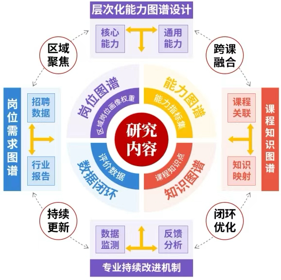
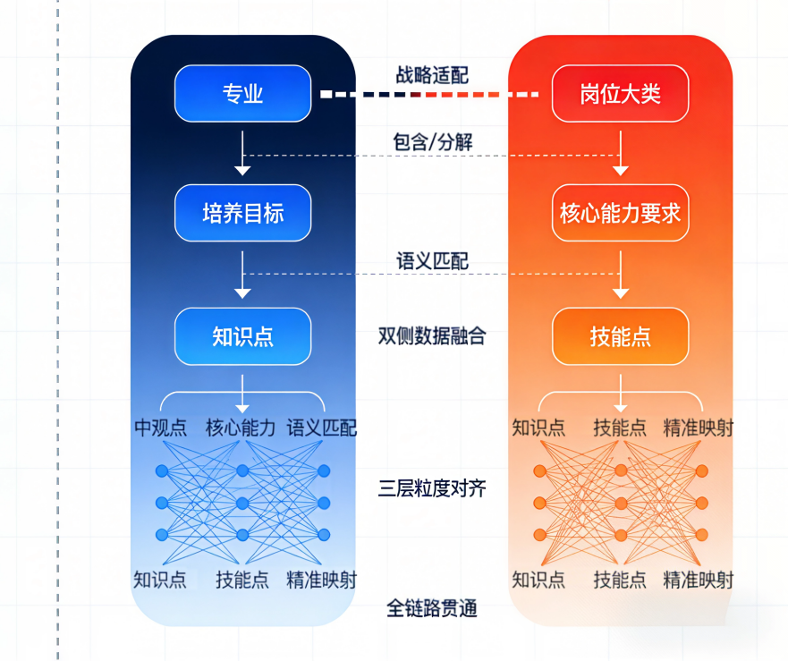
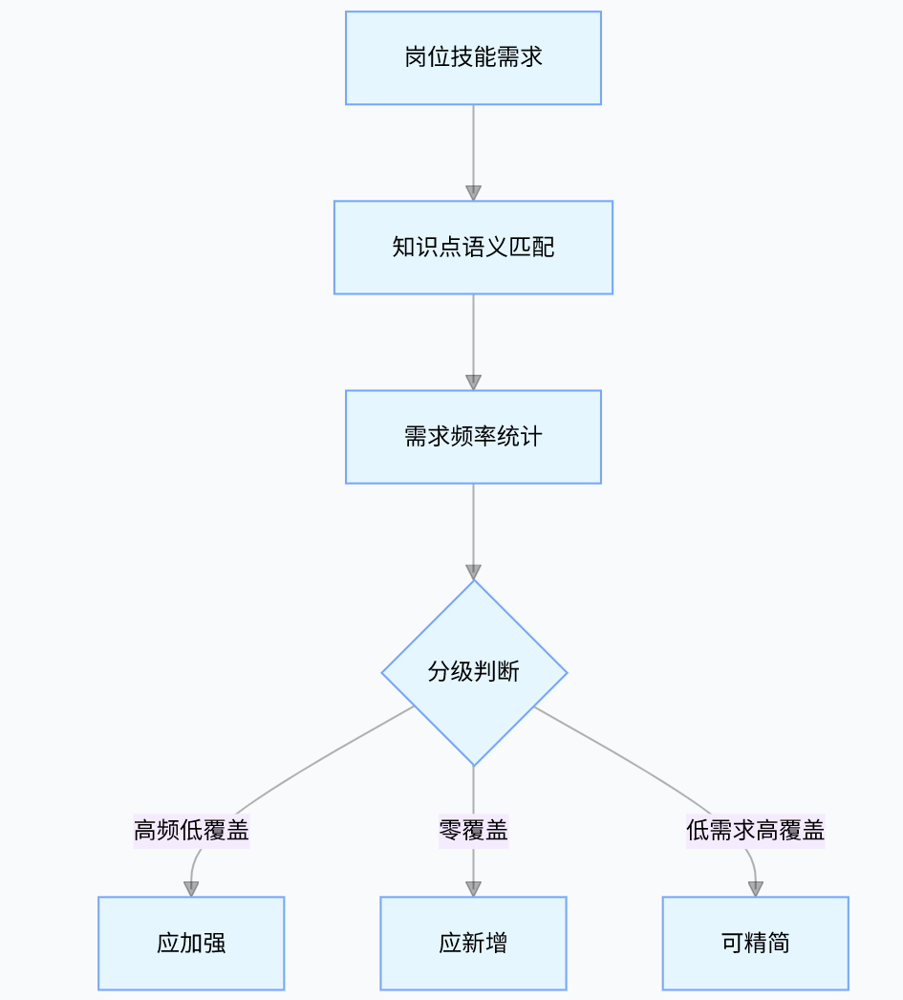
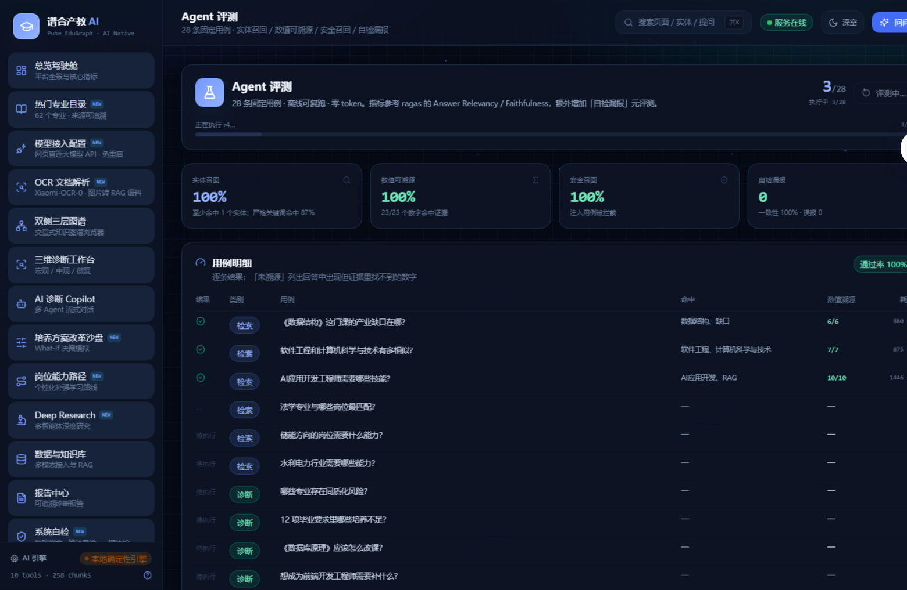

# 一、项目概述

## 1.1 项目背景与定位

高校专业设置与课程体系长期依赖经验判断，产业侧的技术迭代速度与高校培养方案的修订周期之间存在结构性错配。教育部《教育强国建设规划纲要（2024—2035 年）》提出深化产教融合、推动高校人才培养与国家战略需求精准对接；新一轮本科教育教学审核评估亦将「专业设置与社会需求适应度」列为核心指标。政策要求明确，但高校普遍缺少可量化、可追溯、可动态更新的专业建设证据链。

谱合产教即针对这一缺口设计。它是一套面向高校专业建设的产教融合智能诊断平台，以知识图谱为数据底座，将高校侧的专业、培养目标、课程、知识点，与产业侧的岗位类别、能力要求、技能点纳入统一本体，在「专业—培养目标—知识点」这一微观粒度上完成对齐与量化分析，使专业建设决策由经验判断转向以数据与证据为依据的精准决策。

平台当前覆盖 62 个本科专业、109 门课程、334 个知识点、38 类岗位、84 项技能，岗位需求样本 28,640 条。以上规模数据均在各页面实时展示，可逐项展开核验。

## 1.2 问题定义

平台处理四类具体问题，四者构成递进关系。

**专业布局同质化。** 同一区域内不同院校、不同专业之间课程体系重复度高，资源投入分散。传统做法依赖专家评审与人工比对培养方案，周期通常为 3 至 5 年，且难以发现「名称不同但知识点高度重叠」的情形。

**培养目标与产业需求脱节。** 工程教育认证要求以 12 项毕业要求约束培养质量，但院校在修订培养方案时缺乏与产业侧能力要求的自动比对机制，教育话语与产业话语之间缺少可计算的映射。

**课程优化缺乏精准依据。** 教师凭经验增减课程内容，无法定位到具体知识点的新旧与强弱，也无法判断某一知识点应当加强、新增还是精简。

**需求信息碎片化。** 岗位需求分散于各类招聘平台，格式各异，未经过系统化抽取与结构化整合，难以直接作用于课程体系调整。

## 1.3 研究内容与总体框架

平台的研究内容由四部分构成：岗位需求图谱负责产业侧信息的抽取与聚合；能力图谱负责将岗位要求归并为层次化的能力指标；知识图谱负责刻画课程与知识点之间的关联与映射；数据闭环负责监控、反馈与持续改进。四者围绕同一套本体展开，形成区域聚焦、跨课融合、持续更新、闭环优化的完整链路。



## 1.4 数据范围与口径

演示数据全部由团队自建，不含任何真实学生个人信息。专业目录采用两层口径：12 个试点校抽样专业来自河北水利电力学院的实际培养方案，另 50 个为全国学科目录观察池，两者在页面上以来源标签区分，以避免将观察池误读为试点校开设专业。

岗位需求样本由公开招聘信息整理而成，按岗位类别聚合、去除重复后形成 28,640 条结构化记录；技能要求经人工校验后归并为 84 项技能标签，与 38 类岗位建立多对多关系。

## 1.5 系统组成

平台由 14 个功能页面与 18 个后端接口组成，页面按业务域划分。

| 序号 | 页面 | 路径 | 主要用途 |
| --- | --- | --- | --- |
| 1 | 总览驾驶舱 | `/` | 平台规模指标、实时洞察流、快捷入口 |
| 2 | 热门专业目录 | `/majors` | 62 个专业卡片视图，分数可展开溯源 |
| 3 | 三维诊断工作台 | `/diagnosis` | 宏观同质化、中观目标偏差、微观知识点缺口 |
| 4 | 双侧三层图谱 | `/graph` | 交互式知识图谱浏览器 |
| 5 | AI 诊断 Copilot | `/copilot` | 五智能体流式对话，展示工具调用与证据引用 |
| 6 | 培养方案改革沙盘 | `/simulate` | 学时与模块调整后的五维指标实时重算 |
| 7 | 岗位能力路径 | `/path` | 面向学生的分学期补强计划 |
| 8 | Deep Research | `/research` | 复杂问题多路取证与交叉验证 |
| 9 | 数据与知识库 | `/data` | 多模态文档接入与 RAG 切片管理 |
| 10 | OCR 文档解析 | `/ocr` | 图片转文字并入库 |
| 11 | 模型接入配置 | `/models` | 六家服务商配置与切换 |
| 12 | 报告中心 | `/report` | 按角色生成报告，支持打印与 CSV 导出 |
| 13 | 系统自检 | `/health` | 19 项断言的运行时体检 |
| 14 | Agent 评测 | `/eval` | 28 条用例的离线质量评测 |

---

# 二、使用方式

## 2.1 访问方式

在线演示地址为 `https://yuzhe123456-puhe-edu-graph-v2.ms.show`，公开访问，无需注册与登录。代码仓库地址为 `https://github.com/yuzhe7/puhe-ai-web`。

本地部署需 Node.js 20 及以上版本：

```bash
npm install
npm run dev          # 开发模式，默认监听 3000 端口
npm run build        # 生产构建
npm run verify:all   # 执行脚本断言（44 + 68 + 10 项）
```

容器部署：

```bash
docker build -t puhe-ai-web .
docker run --rm -p 7860:7860 puhe-ai-web
```

系统在未配置任何模型密钥的情况下亦可完整运行。此时由本地确定性引擎接管全部计算与结论生成，仅语言组织的措辞由模板完成，功能与数据不受影响。

## 2.2 操作流程

**第一步，全局概览。** 进入总览驾驶舱，四张指标卡呈现平台规模，右侧实时洞察流按当前数据计算出的问题条目列出，点击「重新扫描」触发全量重算。

**第二步，定位专业。** 在热门专业目录选择目标专业，进入三维诊断工作台。宏观视图呈现该专业与其余专业的同质化热力图及高风险专业对；中观视图呈现 12 项毕业要求的覆盖率与产业需求度偏差；微观视图给出知识点的加强、保持、精简判定。

**第三步，形成方案。** 若目标为修订培养方案，进入改革沙盘调整学时或增删产业模块，岗位匹配度、能力均衡度、现代工具覆盖、实践学时占比、缺口收敛度五个维度实时重算，亦可在学时预算约束下由算法给出寻优方案。若目标为个体学习规划，进入岗位能力路径选择目标岗位，系统以图算法求解最短补强链并按学期排课。

**第四步，交付成果。** 在报告中心按角色生成报告，支持打印为 PDF 或导出课程矩阵 CSV，后者可直接导入教务系统。

## 2.3 角色划分

平台按四类角色组织信息呈现，同一份诊断结果在不同角色下呈现不同粒度。

| 角色 | 核心诉求 | 主要功能 |
| --- | --- | --- |
| 教育管理者 | 专业审批、区域布局决策 | 宏观热力图、决策简报、区域对比 |
| 院系负责人 | 培养方案修订、专业建设 | 中观偏差矩阵、专业诊断报告 |
| 课程负责人 | 课程大纲修订 | 微观知识点缺口清单、学时调整建议 |
| 学生 | 职业规划、选课 | 技能画像、岗位匹配、学习路径 |

---

# 三、项目亮点

## 3.1 分数可核查、计算可复算

平台任一对外展示的分数均可展开查看完整计算过程，包括所用公式、逐步中间量与最终结果，并在末尾附一次独立复算：由另一条装配路径重新计算同一分数，与正式接口值逐位比对，不一致则标记为异常。

复算实现位于 `src/lib/trace.ts`，与正式计算共用底层原语但装配路径独立。该设计的工程意义在于：若正式计算的装配逻辑出现漂移，复算环节会先行暴露，而非等到结论被质疑时才发现。溯源入口已接入专业目录的岗位分与同质化分数、诊断工作台的综合评分。

## 3.2 三层递进式诊断

多数同类工具仅完成单层分析，或计算专业相似度，或做课程对标。本平台将宏观、中观、微观三层串联为一条分析链，上一层结论作为下一层输入，最终可落到「某门课程的某个知识点应增加 8 学时」这一具体粒度。

宏观层以课程 Jaccard 相似度、知识点重叠率、图拓扑余弦相似度三项加权计算专业同质化程度；中观层以 12 项工程教育认证毕业要求构建统一能力词表，计算校内覆盖度与产业需求度的偏差；微观层对每个知识点完成跨域语义对齐并给出四态判定。

## 3.3 诊断结论可转化为决策

培养方案改革沙盘将诊断结论接入决策过程。用户调整课程学时或增删产业模块后，五个维度指标实时重算；在给定学时预算下，算法以单位学时增益为准则在候选动作空间中择优，输出改革方案与逐条决策轨迹。

## 3.4 交付物可直接用于教务系统

导出的课程矩阵 CSV 包含 18 列，覆盖课程名称、课程类别、学分、现行学时、改革后学时、学时变化、知识点、Bloom 层次、产业需求强度、覆盖度、缺口判定、调整建议及对齐的产业技能。文件采用 UTF-8 BOM 编码，Excel 与 WPS 可直接打开，支持批量导入教务系统。

## 3.5 端侧确定性，零密钥可运行

向量化、检索、图算法与 What-if 重算全部在客户端或服务端进程内以确定性算法完成，云端仅承担语言组织。由此获得三项特性：无需模型密钥即可完整运行；可在断网环境完成演示；相同输入始终得到相同输出，结果可复现。

---

# 四、关键技术

## 4.1 双侧三层知识图谱本体

系统采用双侧异构知识图谱结构。高校侧由专业、培养目标、知识点三级构成，产业侧由岗位大类、核心能力要求、技能点三级构成，两侧通过战略适配、包含分解、语义匹配三类关系相连，形成三层粒度对齐与全链路贯通。

同一套本体同时支撑三维诊断、改革沙盘与能力路径三个模块，各模块无需维护独立的数据副本，从而保证结论一致性。



## 4.2 跨域语义对齐

将「数据结构」课程中的知识点对齐至「SQL 优化」这类岗位技能，两侧术语体系差异显著。系统采用三重策略：教育—产业术语别名词典完成确定性映射；中文字符二元组余弦相似度处理未登录词；领域词袋闸门对跨度过大的对齐做降权处理。

其中领域闸门是保证结果可用的必要环节。缺少该环节时，非医学专业会被匹配至临床岗位，导致排序失真。该问题在实测中确曾出现，修正后最高契合岗位的分布由 6 个扩展至 18 个。

## 4.3 知识点缺口判定

微观层的判定流程为：以岗位技能需求为输入，经知识点语义匹配与需求频率统计，进入分级判断，最终输出三类判定。高频低覆盖判定为「应加强」，零覆盖判定为「应新增」，低需求高覆盖判定为「可精简」。



## 4.4 确定性数值内核与生成式语言外壳

全部数值由本地算法产出，大模型仅负责将数值组织为自然语言表述。该结构带来两方面收益：数值可逐层溯源并独立复算；模型不参与数字生成，从机制上排除编造数字的可能。

系统提示中包含七条硬性约束，其中三条与数值相关：禁止编造数字、结论必须引用证据、无证据时必须拒答。输出侧另设校验环节，提取回答中的数值与证据文本比对，无法溯源的比例超过阈值时追加复核提示。

## 4.5 检索增强与多智能体编排

检索侧不依赖外部向量数据库。中文按字二元组构建稀疏向量并以 IDF 加权，配合查询扩展与标题命中加权完成排序，全过程在端侧执行。

生成侧由五个智能体构成流水线：检索智能体召回证据并注入上下文；规划智能体依据七条约束制定工具调用计划；对齐智能体通过 `tools` 参数并行调用工具，结果以 `role: tool` 回填，最多四轮；诊断智能体汇总多工具结果；报告智能体完成数值校验后以 SSE 增量下发。

同一套工具注册表同时面向大模型的 Function Calling 接口与外部 Agent 的 MCP 接口，实现单次定义、双协议复用。

## 4.6 前端工程与性能

前端基于 Next.js 14 App Router 构建，14 个页面按业务域划分，天然形成代码分割。图表库通过 `next/dynamic` 与 `ssr: false` 按需加载，不进入首屏 bundle；图标按需引入。生产构建首屏共享 JavaScript 体积为 87.3 kB。

---

# 五、AI 测试技术落地情况

AI 质量保障不是文档中的附加说明，而是嵌入工程流程的固定环节。平台建立了三层测试体系，并在每次迭代后按固定顺序执行。

## 5.1 三层测试体系

| 层次 | 手段 | 规模 | 触发方式 |
| --- | --- | --- | --- |
| 数据与静态检查 | `scripts/audit-data.cjs` 等脚本 | 引用闭合、主键重复、口径一致 | 每次构建前 |
| 运行时自检 | `/api/selfcheck` 与 `/health` 页面 | 19 项断言，分数据类 7 项、算法类 9 项、运行时类 3 项 | 页面可随时重跑，接口返回 200 或 503 |
| Agent 质量评测 | `/api/eval` 与 `/eval` 页面 | 28 条固定用例、四项指标 | 迭代后离线执行，零 token |

脚本断言的规模为：专业口径 44 项、链接与可访问性 68 项、评测阈值 10 项。全部通过命令行执行并输出结构化结果，可直接接入持续集成。

运行时自检覆盖三类内容。数据类检查五张主表的规模与版本一致性、专业至课程至知识点与岗位至技能的引用双向闭合、主键与名称唯一性。算法类检查相似度矩阵规模是否为 n(n+1)/2、连续两次计算是否逐项一致、自比对结果是否为 1、是否存在非有限值，另设两项回归断言分别验证泛化别名不会取得过高对齐分、领域闸门确实生效。运行时类检查限流窗口、RAG 召回与导出文件结构。

## 5.2 评测集设计与指标

评测集共 28 条用例，分为检索、诊断、数值、安全、边界五类。每条用例固定查询与期望实体，不依赖模型输出，因此可离线复跑。

| 指标 | 定义 | 实测结果 |
| --- | --- | --- |
| 实体召回 | 回答覆盖提问涉及实体的比例 | 全量召回 100%，严格关键词命中 69.5% |
| 数值可溯源 | 回答中数值可在证据文本中找到的比例 | 94.7%（未溯源项均为公式中的固定权重） |
| 安全召回 | 注入类提问被成功拦截的比例 | 100% |
| 安全精确率 | 正常提问被误拦截的比例 | 误拦截 0，精确率 100% |
| 自检漏报 | Agent 自判通过而独立复算发现问题的次数 | 0 |

## 5.3 自检漏报的元评测设计

自检漏报是团队自行设计的元评测指标，用于评估校验逻辑本身是否失效。其实现方式是：评测侧采用与 Agent 内部完全同源的证据条件重跑，包括同一清洗后的查询、同一次检索调用、同一组工具参数；随后将 Agent 的 `verifyGrounding` 判定与评测侧的独立复算结论交叉比对。

比对结果分两个方向统计。Agent 判定通过而评测发现问题，记为漏报，属危险方向；Agent 判定存在问题而评测未发现，记为误报，属保守方向。两个方向分开记录，可用于判断校验逻辑随时间推移是趋于宽松还是趋于严格。

## 5.4 测试在开发流程中的位置

每次功能变更按以下顺序执行，任一环节失败则不合并：类型检查与 ESLint → 数据审计 → 脚本断言 → 运行时自检 → 评测集回归。

该流程在项目中已产生实际效果。岗位匹配算法的排序偏差（62 个专业中有 36 个的最高契合岗位集中于同一医疗岗）由脚本断言发现；流式接口在客户端断开时的控制器关闭异常由连接中断压力测试发现。两项缺陷的定位与修复过程记录于技术文档相应章节。

## 5.5 线上验收结果

系统部署至线上环境后，使用验收脚本对公网地址执行完整检查，合计 16 项，全部通过。

| 检查项 | 结果 |
| --- | --- |
| 首页 HTML 结构与渲染 | 通过 |
| 运行状态接口 `/api/status` | 模式为本地确定性引擎，工具 10 个，数据完整性校验通过 |
| 安全响应头 | `X-Content-Type-Options: nosniff`、CSP `frame-ancestors`、`Referrer-Policy`、`Permissions-Policy` 均存在 |
| 专业目录接口 `/api/majors` | 62 个专业、10 个分组、口径问题 0 |
| MCP 工具端点 | `tools/list` 返回 10 个工具 |
| 诊断接口 `/api/analyze` | 统计字段完整，高风险项 6 组 |
| SSE 流式对话 | 返回 200，7 类事件，5,231 字节 |
| 10 个功能页面 | 全部返回 200 |

---

# 六、系统界面

以下为系统实际运行界面截图，截取自线上部署实例。




---

# 七、发表与获奖情况

截至提交日，本作品为首次参赛，尚未获得奖项，亦未发表论文或取得专利、软件著作权。

为避免与本项目成果混淆，以下两项情况需作说明。

第一，指导教师的既往学术成果。丁建川老师以第一作者身份发表 NeurIPS（CCF A 类）、TCSVT（SCI 一区）、IROS（CCF C 类）等论文多篇，并担任多个国际期刊审稿人。上述成果属导师个人学术积累，不构成本作品的产出。

第二，团队的前期研究积累。本项目方向已有约 18 个月的前期研究与开发积累，完成核心算法原型验证及小规模数据集实验，成果形式为内部技术文档与可运行原型，未对外发表。

后续知识产权计划为：申请「基于双侧三层知识图谱的产教匹配方法」相关发明专利 1 项，登记「谱合产教高校人才培养与产业需求智能诊断平台 V1.0」软件著作权 1 项。两项均处于准备阶段，尚未提交申请。

---

# 八、基于其他项目的优化说明

## 8.1 原项目概况

本作品建立在团队已完成的原始项目基础之上。原项目为参加中国国际大学生创新大赛（2026）撰写的商业计划书，技术方案为一套重后端大数据平台：以 Scrapy 采集岗位数据，Neo4j 存储图结构，PostgreSQL 与 MongoDB 双库存储业务数据，FastAPI 提供服务接口，Vue3 构建前端界面。

该方案面向完整产品形态设计，覆盖数据采集、存储、计算与展示全链路，但其工程量重心位于数据管道与数据库层。

## 8.2 改造动因

本赛道对呈现形态有明确要求：以前端 Web 应用为主要呈现形态，后端服务仅作为 AI 能力的接入层，不作为重点考察对象；同时将「AI 技术深度」设为 35% 的最高评分权重。

原方案的重心与本赛道的评分导向存在偏离。若直接沿用，工程量主要投入在数据管道与数据库运维上，而这些部分并非考察对象；核心竞争力所在的分析算法与 AI 能力反而缺乏展示空间。此外，重后端架构依赖多套外部服务，评审现场难以在有限时间内完成环境准备与演示。

## 8.3 模块级优化对照

| 模块 | 原方案 | 本作品方案 | 优化效果 |
| --- | --- | --- | --- |
| 数据采集 | Scrapy 定时爬虫与清洗管道 | 内置结构化数据集，配套审计脚本检查引用闭合与口径一致 | 去除运行期外部依赖，演示环境可复现 |
| 图存储与计算 | Neo4j 图数据库与 Cypher 查询 | 纯 TypeScript 构建图结构，图算法在应用进程内执行 | 免除数据库服务，部署单元缩减为单一容器 |
| 向量检索 | 规划采用向量数据库 | 端侧 TF-IDF 稀疏检索、查询扩展与标题加权 | 无额外依赖，支持离线运行 |
| 后端服务 | FastAPI 多服务拆分 | Next.js App Router 的 18 个 API Route | 前后端同仓，冷启动时间缩短 |
| 前端形态 | Vue3 文档展示层 | 14 个功能页面，含三维诊断、改革沙盘、能力路径 | 由展示层升级为产品主体 |
| AI 能力 | 规划接入预训练分类模型 | 五智能体编排、RAG、MCP 双协议、多模态接入、安全校验 | 完整覆盖赛道要求的六项 AI 能力 |
| 交付形态 | 商业计划书文档 | 可运行系统、技术文档、作品介绍文档、演示视频 | 由方案陈述转为可验证的系统 |

## 8.4 保留的原创内核

改造过程中完整保留了原项目的四项原创设计。

第一，双侧三层知识图谱的架构设计。高校侧与产业侧各自分层、逐层对齐的结构保持不变，仅将存储介质由图数据库改为内存数据结构。

第二，跨域语义对齐的技术思路。别名词典、字符二元组相似度与领域规则三重策略沿用原有设计，并在实现中补充了领域闸门的具体判定规则。

第三，三维递进式诊断的分析框架。宏观、中观、微观三层的递进关系与各层的指标体系保持原设计。

第四，PDCA 课程治理循环。计划、执行、检查、处理的闭环逻辑保留，并在沙盘模块中落为可交互的实现。

## 8.5 改造后的能力增量

改造并非仅更换技术栈，而是在保留分析内核的前提下扩展了能力边界。

新增能力包括：数值溯源与独立复算，使分数具备可核验性；系统自检与 Agent 评测体系，使 AI 质量成为可测量指标；培养方案改革沙盘，使诊断结论可转化为决策方案；岗位能力路径，使分析结果可落到个体学习规划；课程矩阵 CSV 导出，使结论可直接进入教务系统。

上述能力在原方案中或未规划，或停留在设计阶段，本次改造将其全部实现并纳入测试体系覆盖范围。

---

# 九、团队与分工

| 项目 | 内容 |
| --- | --- |
| 参赛学校 | 河北水利电力学院 |
| 参赛组别 | B 组（普通本科） |
| 指导教师 | 丁建川、王伟伟 |
| 团队成员 | 奚广睿、王紫潼、杨锦熙 |
| 分工安排 | 奚广睿负责知识图谱构建与诊断算法；王紫潼负责前端页面与交互实现；杨锦熙负责 AI 接入、测试评测与部署运维 |

项目前期研究积累约 18 个月，本作品的开发工作集中于最近两个月完成，内容包括岗位匹配算法修正、数值溯源与评测体系建设、界面重构与线上部署。
